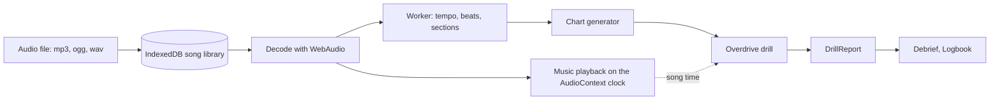
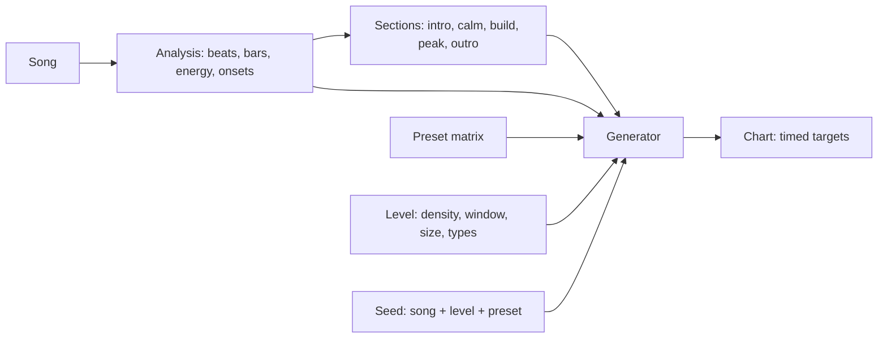
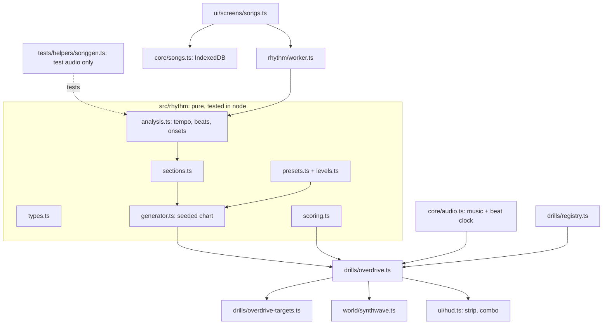

# Architecture

Song to run: the player's audio file is stored in IndexedDB, decoded with WebAudio, and analysed in a worker for tempo, beats and sections (pure functions). The chart generator turns that into timed targets. The Overdrive drill (a normal Drill subclass) plays the music on the AudioContext clock, positions targets from song time, and reports through the usual DrillReport into the debrief and Logbook. It is not part of the daily warm-up (D15).

Proposed chart generator. The song analysis yields the beat grid, bars, per-beat energy and onset strength, and splits the song into sections classified as intro, calm, build, peak or outro. For each bar, the generator takes that bar's section kind, looks up the preset matrix row for it (target-type weights and density), scales it by the level (density, hit window, target size, which types are allowed), and samples spawns with a seeded random generator. Spawns snap to the strongest onsets in the bar. The output is a chart: a list of timed targets with type, position and parameters.

Module map. New pure logic lives in src/rhythm (types, tempo/beat/onset analysis, section detection, presets and the level table, the seeded chart generator, and scoring); all of it runs in vitest without WebAudio or the DOM, tested against generated audio from a test-only helper (tests/helpers/songgen.ts, never shipped). The song screen (src/ui/screens/songs.ts) stores the player's own files in an IndexedDB library (src/core/songs.ts) and runs analysis in a Web Worker (src/rhythm/worker.ts). The Overdrive drill (src/drills/overdrive.ts) takes a chart, reads time from the music clock added to src/core/audio.ts, drives the target behaviours (src/drills/overdrive-targets.ts), the synthwave scene (src/world/synthwave.ts) and the HUD's beat strip and combo (src/ui/hud.ts), and is registered in DRILL_DEFS.

_Generated by live-planner from plan "rhythm-drill" at seq 354. Change the plan and recompile; do not edit by hand._
